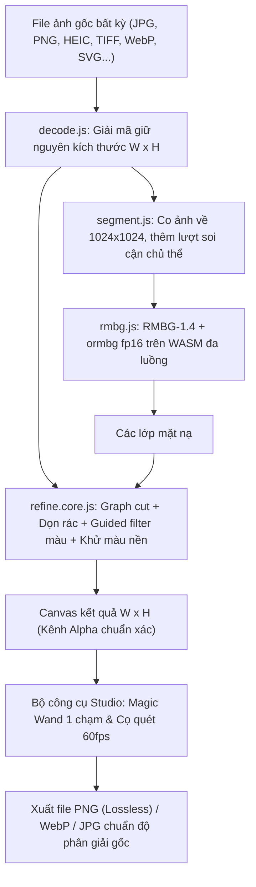

# ✂️ UyCut AI – Tách Nền Chuẩn Độ Phân Giải Gốc

Công cụ web tách phông nền ảnh bằng AI được thiết kế & phát triển bởi **Uy**, **chạy 100% trên trình duyệt** (Client-side, ảnh không bao giờ gửi lên server), hỗ trợ mọi định dạng ảnh và **bảo toàn 100% độ phân giải gốc của ảnh**.

- **Website trực tiếp**: [https://xoa-phong-nen.vercel.app](https://xoa-phong-nen.vercel.app)
- **Mã nguồn GitHub**: [https://github.com/wwm100107-creator/xoa-phong-nen](https://github.com/wwm100107-creator/xoa-phong-nen)

---

## Cách xử lý

AI quyết định đâu là chủ thể, các bước sau chỉ làm đẹp đường viền. Pipeline không chứa luật màu sắc hay vị trí dành riêng cho một loại ảnh.

1. **Hai mô hình bổ sung cho nhau (fp16, ~88MB mỗi mô hình)**: BRIA RMBG-1.4 nhận diện chủ thể, ormbg bổ sung chi tiết RMBG hay bỏ sót như viền giấy sticker, nhưng không được thêm vào nơi RMBG khẳng định là nền. Ảnh được co về 1024×1024 đúng như lúc huấn luyện. Bản lượng tử q8 để lọt nhiều rác nền, còn đệm viền letterbox khiến mô hình nhận cả nền thành chủ thể.
2. **WebAssembly đa luồng**: header COOP/COEP bật cross-origin isolation, mỗi lượt AI chỉ mất khoảng 2-3 giây trên máy nhiều nhân.
3. **Soi cận chủ thể**: khi chủ thể chiếm phần nhỏ của ảnh, AI chạy thêm một lượt trên khung cắt sát. Lượt này chỉ được sửa vùng quanh đường viền.
4. **Quyết định vùng khó bằng graph cut**: vùng AI còn phân vân (chiếc lá, viền giấy sticker) được phân xử theo phân bố màu của chủ thể và nền. Bóng đổ và lớp mờ bị loại, tóc vẫn giữ độ mềm.
5. **Dọn rác**: bỏ đốm tách rời xa chủ thể, giữ vật thể thật và chi tiết gần (tóc rời, khuyên tai, chữ cái của logo).
6. **Viền chất lượng cao**: guided filter đa kênh màu bám biên thật của ảnh, sau đó ước lượng màu tiền cảnh (Germer et al. 2020) để viền không ám màu phông cũ.

Khi cần chỉnh tay, ví dụ băng dính hay vật gá nằm tách rời mà AI coi là chủ thể, dùng các công cụ dưới đây.

**Bộ công cụ Studio tương tác thời gian thực (60 FPS)**:
   - ⇆ **Kéo so sánh (Compare slider)**: Kéo trước / sau mượt mà.
   - 🪄 **Đũa thần 1 chạm (Magic Wand)**: Bấm 1 nhấp chuột vào bất kỳ vệt bóng, chữ viết tay hay mũi tên thừa để xóa sạch theo vùng màu tương đồng.
   - 🧹 **Cọ xóa (Erase brush)** & 🖌️ **Cọ lấy lại (Restore brush)**: Quét cọ thủ công trực tiếp lên độ phân giải gốc.
   - 🔍 **Phóng to để chỉnh chi tiết**: lăn chuột để phóng to vào đúng chỗ con trỏ, giữ dấu cách hoặc chuột giữa rồi kéo để di chuyển ảnh.
   - 👁️ **Giữ phím để xem ảnh gốc**: khi dùng đũa thần hoặc cọ, giữ `Ctrl` để hiện mờ ảnh gốc ở lớp dưới. Có thể đổi sang phím khác hoặc nút chuột.
   - ↩️ **Hoàn tác (Undo)** & ↺ **Đặt lại AI ban đầu**.

---

## Kiến trúc & Luồng xử lý kỹ thuật



---

## Hướng dẫn cài đặt & Chạy trên máy

```bash
# Cài đặt thư viện
npm install

# Khởi chạy server phát triển
npm run dev

# Đóng gói sản phẩm
npm run build

# Xem thử bản build
npm run preview
```

## Tác giả & Bản quyền
- Thiết kế & phát triển: **Uy**
- Bản quyền: MIT License
