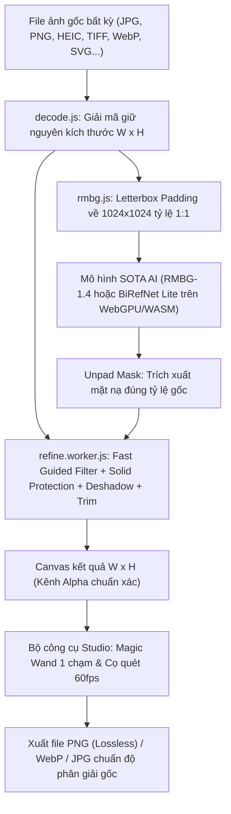

# ✂️ UyCut AI 3.0 – Tách Nền Chuẩn Độ Phân Giải Gốc

Công cụ web tách phông nền ảnh bằng AI hiện đại nhất được thiết kế & phát triển bởi **Uy**, **chạy 100% trên trình duyệt** (Client-side, ảnh không bao giờ gửi lên server), hỗ trợ mọi định dạng ảnh và **bảo toàn 100% độ phân giải gốc của ảnh**.

- **Website trực tiếp**: [https://xoa-phong-nen.vercel.app](https://xoa-phong-nen.vercel.app)
- **Mã nguồn GitHub**: [https://github.com/wwm100107-creator/xoa-phong-nen](https://github.com/wwm100107-creator/xoa-phong-nen)

---

## Tính năng đột phá trong phiên bản 3.0

1. **Chuẩn hóa khung hình Letterbox 1:1 Aspect-Ratio**:
   - Tránh việc bóp méo hình chữ nhật thành hình vuông 1024×1024 khi nạp vào AI.
   - Nhờ đệm viền trung tính (Padding), AI nhận dạng chính xác từng cuống lá, độ cong quả cam, viền sticker mà không bị biến dạng hình học.
2. **Dual SOTA AI: RMBG-1.4 Studio & BiRefNet Lite**:
   - **BRIA RMBG-1.4 Studio** (~44MB): Siêu nhanh, nhận dạng cực nhạy, tiết kiệm RAM.
   - **BiRefNet Lite** (~114MB - ECCV 2024 DIS Winner): Kiến trúc Bilateral Reference Network cho đường viền mượt mà, siêu sắc nét.
3. **Cơ chế Solid Subject Protection (Bảo vệ chi tiết tối)**:
   - Các chi tiết tối màu (như lá cây xanh đậm, tóc tơ, đồng tử, vân nhám) có xác suất AI $\ge 0.70$ được **bảo vệ 100% độ đặc**, không bao giờ bị bộ lọc độ sáng biến thành trong suốt hay rỗng ruột.
4. **Thuật toán Smart Deshadow (Tự động triệt tiêu bóng đổ)**:
   - Tự động phát hiện và loại bỏ các vệt bóng xám/nâu bẩn đổ dưới đáy quả hoặc sticker trên mặt bàn/giấy.
5. **Thu gọn viền / Bóc viền thừa (Edge Trim / Shrink)**:
   - Cho phép co viền từ 0 - 6px chỉ trong 10ms, giúp bóc sạch viền giấy trắng của sticker hoặc viền lem màu nền cũ.
6. **Bộ công cụ Studio tương tác thời gian thực (60 FPS)**:
   - ⇆ **Kéo so sánh (Compare slider)**: Kéo trước / sau mượt mà.
   - 🪄 **Đũa thần 1 chạm (Magic Wand)**: Bấm 1 nhấp chuột vào bất kỳ vệt bóng, chữ viết tay hay mũi tên thừa để xóa sạch theo vùng màu tương đồng.
   - 🧹 **Cọ xóa (Erase brush)** & 🖌️ **Cọ lấy lại (Restore brush)**: Quét cọ thủ công trực tiếp lên độ phân giải gốc.
   - ↩️ **Hoàn tác (Undo)** & ↺ **Đặt lại AI ban đầu**.

---

## Kiến trúc & Luồng xử lý kỹ thuật



### 1. Giải mã đa định dạng (`decode.js`)
Đọc 32 byte đầu file (Magic Bytes) để nhận diện định dạng chuẩn:
- **HEIC / HEIF (iPhone)**: Giải mã bằng `heic2any` qua Web Worker.
- **TIFF / TIF**: Giải mã bằng `utif2` hỗ trợ đa trang, RGB/CMYK.
- **SVG**: Kết xuất vector lên canvas đúng `naturalWidth`/`naturalHeight`.
- **PNG / WebP / JPG / AVIF / BMP / ICO**: Tự động giải mã qua `createImageBitmap` tăng tốc phần cứng.

### 2. Tiền xử lý Letterbox & Suy luận AI (`rmbg.js` & `segment.js`)
- Tự động tính toán tỷ lệ co giãn $s = 1024 / \max(W, H)$ và tọa độ bù trừ $(dx, dy)$ để đặt ảnh vào giữa khung 1024×1024.
- Mặt nạ xuất ra từ mô hình được gỡ đệm (Unpad) bằng phép biến đổi affine ngược, đảm bảo độ chính xác tọa độ pixel tuyệt đối.

### 3. Tinh chỉnh viền & Bảo vệ chủ thể (`refine.worker.js`)
- **Fast Guided Filter** chạy với độ phức tạp $O(N)$ bằng Box Filter 2 lượt (ngang & dọc).
- Tách biệt dải bất định: Chỉ can thiệp vào viền biên mềm ($0.12 < \alpha < 0.70$). Vùng chủ thể chắc chắn giữ nguyên $1.0$.

---

## Hướng dẫn cài đặt & Chạy trên máy

```bash
# Cài đặt thư viện
npm install

# Khởi chạy server phát triển
npm run dev

# Đóng gói sản phẩm
npm run build

# Xem thử bản build
npm run preview
```

## Tác giả & Bản quyền
- Thiết kế & phát triển: **Uy**
- Bản quyền: MIT License
