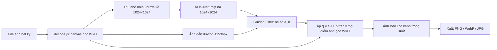

# ✂️ UyCut AI – Xóa Phông Nền Giữ Nguyên Độ Phân Giải

Công cụ web xóa phông nền ảnh bằng AI phát triển bởi **Uy**, **chạy 100% trên trình duyệt** (ảnh không bị tải lên server), hỗ trợ hầu hết định dạng ảnh và **xuất ra đúng kích thước, độ nét của ảnh gốc**.

## Tính năng

- Hỗ trợ: **JPG, PNG, WebP, AVIF, GIF, BMP, ICO, SVG, HEIC/HEIF (ảnh iPhone), TIFF**
- Giữ nguyên độ phân giải: ảnh 6000×4000 vào → ảnh 6000×4000 ra
- Tinh chỉnh viền bằng **Guided Filter** bám theo chi tiết ảnh gốc (tóc, lông thú…)
- Thanh trượt chỉnh viền theo thời gian thực (không cần chạy lại AI)
- So sánh Trước/Sau bằng thanh kéo
- Nền xuất ra: trong suốt, màu có sẵn, hoặc màu tùy chọn
- Xuất PNG (không mất dữ liệu), WebP, JPG
- Xử lý nhiều ảnh cùng lúc (hàng đợi), kéo thả, dán Ctrl+V
- Tự dùng **WebGPU** nếu có, nếu không thì chạy bằng WebAssembly (CPU)

## Chạy trên máy

```bash
npm install
npm run dev      # chạy thử tại http://localhost:5173
npm run build    # build ra thư mục dist/
```

## Cấu trúc mã nguồn

| File | Vai trò |
|---|---|
| `index.html` | Giao diện: vùng thả ảnh, cài đặt, khung so sánh, danh sách ảnh |
| `src/main.js` | Điều phối: hàng đợi, gọi giải mã → AI → tinh chỉnh → xuất file |
| `src/decode.js` | Giải mã **mọi định dạng** ảnh về canvas đúng kích thước gốc |
| `src/segment.js` | Chạy mô hình AI IS-Net để lấy mặt nạ chủ thể 1024×1024 |
| `src/refine.worker.js` | **Fast Guided Filter**: phóng mặt nạ về độ phân giải gốc, ghép kênh alpha |
| `src/style.css` | Giao diện |

## Logic thực hiện (chi tiết)



### Bước 1 – Giải mã ảnh ở độ phân giải gốc (`decode.js`)

1. Đọc 32 byte đầu file (“magic bytes”) để biết định dạng thật, vì trên Windows file HEIC/TIFF thường không có MIME type.
   - `II*\0` / `MM\0*` → TIFF
   - `....ftyp` + `heic/mif1…` → HEIC; `avif` → AVIF
   - `<svg` / `<?xml` → SVG
2. Mỗi định dạng có cách giải mã riêng:
   - **JPG/PNG/WebP/AVIF/GIF/BMP/ICO**: `createImageBitmap(file, { imageOrientation: 'from-image' })` – dùng bộ giải mã gốc của trình duyệt và **tự xoay theo EXIF** (ảnh chụp điện thoại không bị nằm ngang).
   - **HEIC**: thử giải mã gốc (Safari làm được); nếu thất bại dùng `heic2any` chuyển sang PNG (giữ nguyên kích thước).
   - **TIFF**: dùng `UTIF` giải mã ra RGBA; nếu file có nhiều trang thì chọn trang lớn nhất (tránh lấy nhầm thumbnail).
   - **SVG**: là ảnh vector nên được render ở cạnh dài tối thiểu 2048px.
3. Kết quả: một `<canvas>` kích thước **W×H đúng bằng ảnh gốc**.

### Bước 2 – Chuẩn bị đầu vào cho AI (`segment.js`)

Mô hình IS-Net chỉ nhận ảnh **1024×1024**. Nếu thu nhỏ một bước từ 6000px xuống 1024px sẽ bị răng cưa (aliasing), làm AI nhận diện kém. Vì vậy hàm `resizeHQ()` **giảm ½ liên tục** (6000 → 3000 → 1500 → 1024), mỗi bước bật `imageSmoothingQuality = 'high'`.

### Bước 3 – AI dự đoán mặt nạ (`segment.js`)

- Thư viện `@imgly/background-removal` chạy mô hình ONNX bằng ONNX Runtime Web.
- Ưu tiên `device: 'gpu'` (WebGPU), lỗi thì tự quay về `cpu` (WebAssembly).
- Có 3 mức mô hình: `isnet` (chính xác nhất), `isnet_fp16` (cân bằng), `isnet_quint8` (nhẹ nhất). Mô hình tải từ CDN **một lần**, sau đó trình duyệt cache lại.
- Đầu ra yêu cầu dạng thô `image/x-rgba8` (không nén lại PNG), mặt nạ nằm ở kênh alpha: **255 = chủ thể, 0 = nền**.

### Bước 4 – Giữ độ phân giải: Fast Guided Filter (`refine.worker.js`)

Đây là phần quan trọng nhất. Mặt nạ chỉ có 1024×1024; nếu phóng to thẳng lên 6000×4000 thì viền sẽ **mờ và bậc thang**, tóc bị mất.

**Ý tưởng Guided Filter** (Kaiming He): trong một vùng nhỏ, alpha là hàm tuyến tính của độ sáng ảnh:

```
q(x) = a · I(x) + b
```

- `I` = độ sáng của ảnh gốc, `p` = mặt nạ thô của AI.
- Trong mỗi cửa sổ bán kính `r`, tìm `a, b` khớp nhất với `p`:
  - `a = cov(I, p) / (var(I) + eps)`
  - `b = mean(p) − a · mean(I)`
- Vùng đặc (toàn chủ thể hoặc toàn nền): `cov = 0` ⇒ `a = 0`, `b = p` ⇒ giữ nguyên.
- Vùng viền: `a ≠ 0` ⇒ alpha **đi theo biên sáng/tối thật** của ảnh gốc.

**Phiên bản “Fast”** để chạy được ảnh hàng chục megapixel:
1. Tính `a, b` ở lưới thấp (cạnh dài ≤ 1536px) – tốn ít RAM.
2. Các phép trung bình dùng **box filter tổng trượt O(N)** – tốc độ không phụ thuộc bán kính.
3. Với **từng điểm ảnh gốc** (x, y): nội suy song tuyến `a, b` rồi tính `alpha = a · I_gốc(x,y) + b`. Vì `I_gốc` lấy ở độ phân giải đầy đủ nên viền sắc nét đúng như ảnh gốc.

Toàn bộ bước này chạy trong **Web Worker** để giao diện không bị đơ, và mảng điểm ảnh được *chuyển quyền sở hữu* (transferable) sang worker thay vì sao chép.

### Bước 5 – Làm sạch alpha

- `alpha < Lọc nhiễu nền` → 0 (xóa vệt nền mờ còn sót)
- `alpha > Độ đặc chủ thể` → 1 (chủ thể không bị lỗ chỗ trong suốt)
- Ở giữa: nội suy tuyến tính để viền mượt
- Nếu ảnh gốc đã có trong suốt (PNG) thì nhân thêm với alpha gốc.

Mặt nạ AI được lưu lại ⇒ khi kéo thanh trượt chỉ chạy lại bước 4–5 (vài trăm ms), **không chạy lại AI**.

### Bước 6 – Ghép và xuất file

- Chỉ ghi **kênh alpha**; R, G, B của mọi điểm ảnh giữ nguyên ⇒ chất lượng màu như ảnh gốc.
- PNG/WebP + nền trong suốt: mã hóa thẳng canvas kết quả.
- Có màu nền hoặc JPG: tạo canvas W×H, tô màu nền rồi vẽ kết quả lên trên.
- Tên file: `ten-anh-xoa-nen.png`.

## Giới hạn

- Kích thước tối đa phụ thuộc giới hạn canvas của trình duyệt (Chrome/Edge/Firefox: ~ 268 triệu điểm ảnh; Safari iOS: ~16,7 triệu điểm ảnh).
- Lần đầu cần tải mô hình (40–170MB tùy mức chất lượng).

## Giấy phép

Mã nguồn phát hành theo **AGPL-3.0** do sử dụng thư viện [`@imgly/background-removal`](https://github.com/imgly/background-removal-js) (AGPL-3.0).
