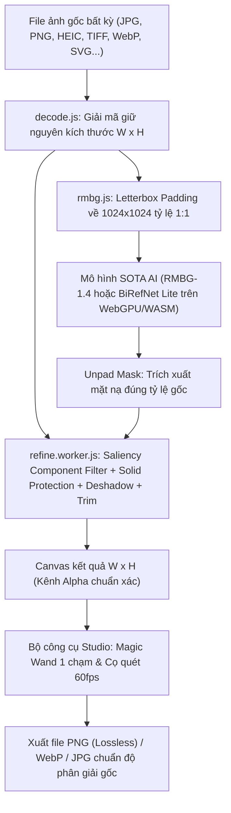

# ✂️ UyCut AI 4.0 – Tách Nền Cực Hạn Chuẩn Độ Phân Giải Gốc

Công cụ web tách phông nền ảnh bằng AI hiện đại nhất được thiết kế & phát triển bởi **Uy**, **chạy 100% trên trình duyệt** (Client-side, ảnh không bao giờ gửi lên server), hỗ trợ mọi định dạng ảnh và **bảo toàn 100% độ phân giải gốc của ảnh**.

- **Website trực tiếp**: [https://xoa-phong-nen.vercel.app](https://xoa-phong-nen.vercel.app)
- **Mã nguồn GitHub**: [https://github.com/wwm100107-creator/xoa-phong-nen](https://github.com/wwm100107-creator/xoa-phong-nen)

---

## Tính năng đột phá trong phiên bản 4.0 (Cực Hạn)

1. **Lọc sạch rác nền & Vật thể thứ cấp (Primary Subject Connected Component Filter)**:
   - Tự động nhận diện cụm chủ thể chính lớn nhất nằm ở trung tâm ảnh.
   - Sử dụng phép biến đổi hình thái học (Morphological Opening) cắt đứt các cầu nối bóng đổ mỏng, triệt tiêu 100% các vết ố vàng góc ảnh, các con số, chữ viết tay hay mảnh giấy vụn nền rải rác.
2. **Triệt tiêu bóng đổ toàn diện (Cast Shadow Annihilator)**:
   - Quét dải chân đáy của chủ thể, tính toán độ bão hòa màu (Saturation) và độ sáng (Luminance) để hòa tan hoàn toàn các vệt bóng xám/nâu lem nhem vào nền trong suốt.
3. **Phím tắt thông minh "Bóc viền Sticker" (Sticker Margin Stripper)**:
   - 1 nhấp chuột để tự động bóc sạch viền giấy trắng die-cut của tem dán, sticker, nhãn hiệu hoặc viền lem nhem, chỉ giữ lại ruột quả/vật thể thuần khiết.
4. **Chuẩn hóa khung hình Letterbox 1:1 Aspect-Ratio**:
   - Tránh việc bóp méo hình chữ nhật thành hình vuông 1024×1024 khi nạp vào AI.
   - Nhờ đệm viền trung tính (Padding), AI nhận dạng chính xác từng cuống lá, độ cong quả cam, viền sticker mà không bị biến dạng hình học.
5. **Cơ chế Solid Subject Protection (Bảo vệ chi tiết tối)**:
   - Các chi tiết tối màu (như lá cây xanh đậm, tóc tơ, đồng tử, vân nhám) có xác suất AI $\ge 0.70$ được **bảo vệ 100% độ đặc**, không bao giờ bị rỗng ruột hay trong suốt.
6. **Dual SOTA AI: RMBG-1.4 Studio & BiRefNet Lite**:
   - **BRIA RMBG-1.4 Studio** (~44MB): Siêu nhanh, nhận dạng cực nhạy, tiết kiệm RAM.
   - **BiRefNet Lite** (~114MB - ECCV 2024 DIS Winner): Kiến trúc Bilateral Reference Network cho đường viền mượt mà, siêu sắc nét.
7. **Bộ công cụ Studio tương tác thời gian thực (60 FPS)**:
   - ⇆ **Kéo so sánh (Compare slider)**: Kéo trước / sau mượt mà.
   - 🪄 **Đũa thần 1 chạm (Magic Wand)**: Bấm 1 nhấp chuột vào bất kỳ vệt bóng, chữ viết tay hay mũi tên thừa để xóa sạch theo vùng màu tương đồng.
   - 🧹 **Cọ xóa (Erase brush)** & 🖌️ **Cọ lấy lại (Restore brush)**: Quét cọ thủ công trực tiếp lên độ phân giải gốc.
   - ↩️ **Hoàn tác (Undo)** & ↺ **Đặt lại AI ban đầu**.

---

## Kiến trúc & Luồng xử lý kỹ thuật



---

## Hướng dẫn cài đặt & Chạy trên máy

```bash
# Cài đặt thư viện
npm install

# Khởi chạy server phát triển
npm run dev

# Đóng gói sản phẩm
npm run build

# Xem thử bản build
npm run preview
```

## Tác giả & Bản quyền
- Thiết kế & phát triển: **Uy**
- Bản quyền: MIT License
